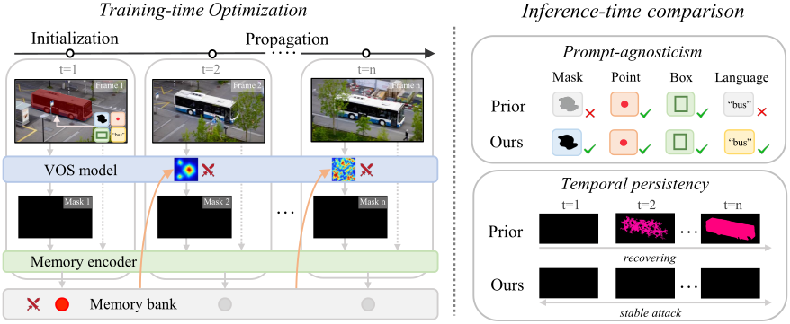
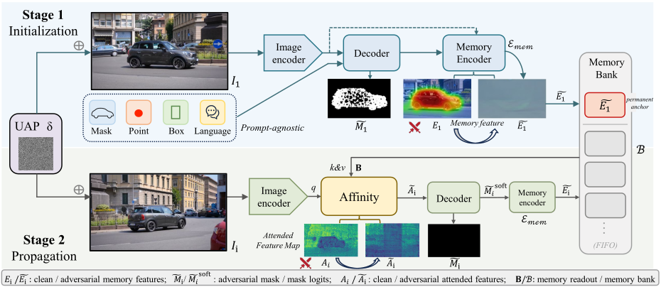
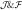
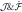

<h1 align="center">
Attack-Inference Aligned Universal Adversarial<br>
Attacks on Video Object Segmentation
</h1>

<p align="center">
  <strong>Ruiqi Shen</strong><sup>1</sup>
  ·
  <a href="https://changliu19.github.io/"><strong>Chang Liu</strong></a><sup>2✉</sup>
  ·
  <a href="https://henghuiding.com/"><strong>Henghui Ding</strong></a><sup>1✉</sup>
</p>

<p align="center">
  <sup>1</sup>Fudan University &nbsp;&nbsp;
  <sup>2</sup>Shanghai University of Finance and Economics<br>
  <sup>✉</sup>Corresponding authors
</p>

<p align="center">
  <a href="https://henghuiding.com/AUV"></a>
  <a href="TODO"></a>
</p>

<p align="center">
  <strong>AUV</strong> is a UAP-based attack framework that aligns attack optimization with the two-stage VOS inference paradigm.<br>
  It enables <strong>fast, sustained, and prompt-agnostic attacks</strong> on real-world videos.
</p>

<p align="center">
  
</p>

## ✨ Highlights

- **Attack-inference alignment** — Tailored objectives for attacking target initialization and memory-based propagation within VOS.
- **SOTA attack performance** — Reduces SAM3’s $`\mathcal{J}\&\mathcal{F}`$ to 8.4 on DAVIS17.
- **Prompt-agnostic attacks** — Zero-shot transfer across masks, points, boxes, and language.
- **Temporal dynamics** — Rapid onset, persistent coverage, and flexible mid-video attacks.

## 📋 TODO

- ✅ Release the attack training and inference code.
- ✅ Release the UAP checkpoints for reference.
- ✅ Release the evaluation code for temporal metrics.

## 🧠 Method

<p align="center">
  
</p>

| Initialization | Propagation |
| :---: | :---: |
| Corrupt the permanent memory anchor $\tilde{E}_1$ | Flatten the spatial saliency of memory-attended features $\tilde{A}_i$, $i \geq 2$ |

## 📊 Results

<table style="border-collapse: collapse; text-align: center;">
<thead>
<tr>
<th rowspan="2" align="left" style="text-align: left; vertical-align: middle;">Benchmark</th>
<th rowspan="2" align="center" style="text-align: center; vertical-align: middle;">Metric ↓</th>
<th colspan="2" align="center" style="text-align: center; border-bottom: 1px solid #999;">SAM3</th>
<th colspan="2" align="center" style="text-align: center; border-bottom: 1px solid #999;">SAM2.1-B+</th>
</tr>
<tr>
<th align="center" style="text-align: center; padding: 8px 16px;">Clean</th>
<th align="center" style="text-align: center; padding: 8px 16px;">Attacked</th>
<th align="center" style="text-align: center; padding: 8px 16px;">Clean</th>
<th align="center" style="text-align: center; padding: 8px 16px;">Attacked</th>
</tr>
</thead>
<tbody>
<tr>
<td align="left" style="text-align: left; padding: 8px 16px;">DAVIS17</td>
<td align="center" valign="middle"></td>
<td align="center">92.2</td>
<td align="center"><strong>8.4</strong></td>
<td align="center">89.0</td>
<td align="center"><strong>12.1</strong></td>
</tr>
<tr>
<td align="left" style="text-align: left; padding: 8px 16px;">YTVOS19</td>
<td align="center" valign="middle"></td>
<td align="center">89.7</td>
<td align="center"><strong>14.0</strong></td>
<td align="center">88.0</td>
<td align="center"><strong>19.2</strong></td>
</tr>
<tr>
<td align="left" style="text-align: left; padding: 8px 16px;">MOSEv2</td>
<td align="center" valign="middle"></td>
<td align="center">60.3</td>
<td align="center"><strong>24.6</strong></td>
<td align="center">46.0</td>
<td align="center"><strong>26.5</strong></td>
</tr>
<tr>
<td align="left" style="text-align: left; padding: 8px 16px;">MOSEv1</td>
<td align="center" valign="middle"></td>
<td align="center">78.4</td>
<td align="center"><strong>21.1</strong></td>
<td align="center">73.6</td>
<td align="center"><strong>23.2</strong></td>
</tr>
</tbody>
</table>

## ⚙️ Installation
```bash
# clone the repo and enter directory
git clone https://github.com/FudanCVL/AUV.git
cd AUV

# create and activate conda environment
conda create -n auv python=3.10 -y
conda activate auv

# install required packages
pip install -r requirements.txt
```

## 🧠 Checkpoints

Place the VOS checkpoints and the UAPs under the `checkpoints/` directory. We use SAM2.1-B+ as the representative SAM2 variant.

| VOS | Checkpoint |
| :--- | :--- |
| SAM2.1-B+ | [`checkpoints/sam2.1_hiera_base_plus.pt`](https://dl.fbaipublicfiles.com/segment_anything_2/092824/sam2.1_hiera_base_plus.pt) |
| SAM3 | [`checkpoints/sam3.pt`](https://huggingface.co/facebook/sam3) |

The UAPs for SAM3 and SAM2.1-B+ are provided for reference. You can also train your own UAP using the released code, as described below.

## 🗂️ Data Preparation

Following [UAP-SAM2](https://github.com/CGCL-codes/UAP-SAM2), we train on the YTVOS (YouTube-VOS) 2018 training set and evaluate on validation sets below:

| Usage | Dataset | Download |
| :--- | :--- | :--- |
| Training | YTVOS18-train | [Google Drive](https://drive.google.com/drive/folders/1L9JAl1BCtzomRJ34tKsU9tJUmF-ZMFOM) |
| Evaluation | DAVIS17-val | [ETH link](https://data.vision.ee.ethz.ch/csergi/share/davis/DAVIS-2017-trainval-480p.zip) |
| Evaluation | YTVOS19-val | [Google Drive](https://drive.google.com/drive/folders/1XwjQ-eysmOb7JdmJAwfVOBZX-aMbHccC) |
| Evaluation | MOSEv1-val | [Google Drive](https://drive.google.com/drive/folders/1vChKHzbboP1k6wd6t95guxxURW3nIXBe) |
| Evaluation | MOSEv2-val | [Hugging Face](https://huggingface.co/datasets/FudanCVL/MOSEv2/blob/main/valid.tar.gz) |

Set `paths.vos_root` in the `attack.yaml` configuration files for both SAM2 and SAM3 to the training-set directory:
```
paths:
  vos_root: /path/to/YTVOS18-train/
```

## 🏋️ Training

Run all commands from the repo root after preparing the datasets above.

| VOS | Training script | Config | Output directory |
| :--- | :--- | :--- | :--- |
| SAM2.1-B+ | `sam2/training/train.py` | [attack.yaml](sam2/sam2/configs/attack.yaml) | `runs/sam2_base_plus/` |
| SAM3 | `sam3/train/train.py` | [attack.yaml](sam3/train/configs/attack.yaml) | `runs/sam3/` |

For example, train SAM3 attack with:

```bash
python sam3/train/train.py --num-gpus 1
```

You may reduce the default 10 epochs per stage in `attack.yaml` to 5. It can still retain SOTA attack performance.

## 🚀 Inference

Select the inference script based on the VOS model and initial-frame prompt type:

| Prompt type | SAM2.1-B+ | SAM3 |
| :---: | :---: | :---: |
| Mask | `sam2/tools/vos_inference_attack_mask.py` | `sam3/eval/vos_inference_attack_mask.py` |
| Point | `sam2/tools/vos_inference_attack_point.py` | `sam3/eval/vos_inference_attack_point.py` |
| Box | `sam2/tools/vos_inference_attack_box.py` | `sam3/eval/vos_inference_attack_box.py` |

For example, evaluate the SAM3 UAP on DAVIS17 with mask prompts:

```bash
python sam3/eval/vos_inference_attack_mask.py \
  --checkpoint_path checkpoints/sam3.pt \
  --uap_checkpoint runs/sam3/stage2/checkpoints/checkpoint.pt \
  --base_video_dir /data/davis17/valid/JPEGImages \ # change to your path
  --input_mask_dir /data/davis17/valid/Annotations \
  --output_mask_dir output/sam3_mask \
  --num_gpus 1
```

### Language Prompts (SAM3 Only)

For a qualitative comparison, run clean and UAP-attacked SAM3 on `assets/people.mp4` with the default text prompt `person`:

```bash
python sam3/eval/vos_inference_attack_language.py \
  --uap_checkpoint runs/sam3/stage2/checkpoints/checkpoint.pt \
  --output_dir output/sam3_language
```


## ⏱️ Temporal Metrics

Evaluate attack onset speed ($\mathit{Lat}\downarrow$), coverage ($\mathit{Cov}\uparrow$), and mid-video coverage ($\mathit{Cov}_{20}\uparrow$):

```bash
python temporal_metrics.py \
  --gt /data/davis17/valid/Annotations \
  --benign output/sam3_mask_clean \
  --attack output/sam3_mask \
  -n 16 \
  --attack20 output/sam3_mask_20 # optional
```

By default, the script reports scores for each video-object pair and the global averages.

## 📚 Acknowledgements & Citation

We are inspired by excellent VOS models such as [SAM2](https://github.com/facebookresearch/sam2) and [SAM3](https://github.com/facebookresearch/sam3), as well as pioneering adversarial attacks such as [UAP-SAM2](https://github.com/CGCL-codes/UAP-SAM2), and many other not listed.

If you find this work useful, please consider citing:

```bibtex
@inproceedings{shen2026auv,
  title={Attack-Inference Aligned Universal Adversarial Attacks on Video Object Segmentation},
  author={Shen, Ruiqi and Liu, Chang and Ding, Henghui},
  booktitle={Advances in Neural Information Processing Systems},
  year={2026},
  url={https://github.com/FudanCVL/AUV}
}
```

## ⚖️ License

The UAP checkpoints are licensed exclusively for non-commercial research only.
